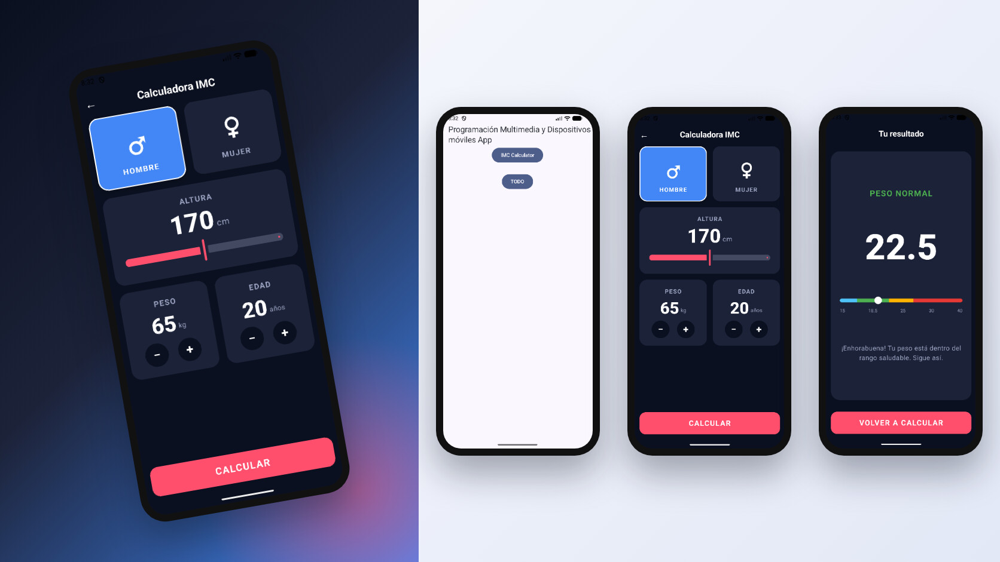
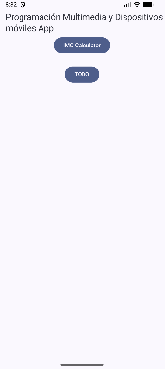
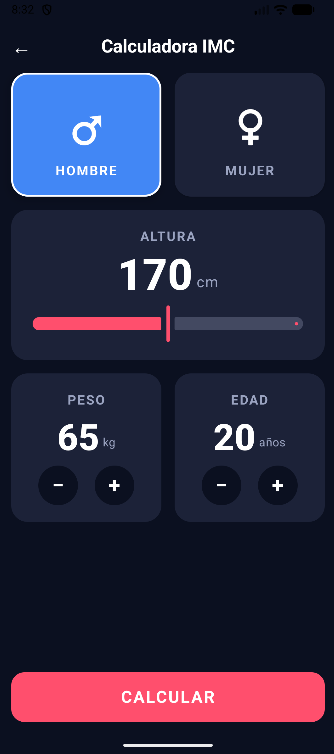
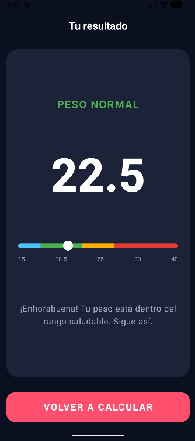

<div align="center">
  
</div>

<div align="center">
  <a href="https://github.com/evagr11/IMCApp/releases/latest" target="_blank"></a>
  <a href="https://github.com/evagr11/IMCApp" target="_blank"></a>
  <a href="https://evagr11.github.io/IMCApp/kdoc/" target="_blank"></a>
  <a href="docs/Documentacion_IMCApp.pdf" target="_blank"></a>
  <a href="https://evagr11.github.io/Curriculum/proyectos/imcapp.html" target="_blank"></a>
</div>

<div align="center">
  <a href="https://git.io/typing-svg"></a>
</div>

<div align="center">
  
</div>

# Sobre el Proyecto

**IMCApp** es una calculadora del **Índice de Masa Corporal** para Android hecha con **Kotlin y Jetpack Compose**. Eliges el género, la altura, el peso y la edad, pulsas *Calcular* y la app muestra tu IMC con su categoría según los rangos de la OMS.

La app se ha hecho en clase siguiendo los apuntes de la profesora de PMDM (UT3, basados en el curso de Android con Kotlin y Jetpack Compose de AristiDev): el menú principal (módulo 5), la navegación con Navigation 3 (módulo 6), los selectores de género y altura (módulos 7 y 7.2), los contadores de peso y edad con la pantalla de resultado (módulo 7.3) y la mejora del aspecto de las dos pantallas (módulo 7.4).

**Cambios propios respecto a los apuntes:**

*   **Diseño:** Tema azul noche con tarjetas oscuras, azul para la opción seleccionada y rosa para los botones principales, todo en `Color.kt`.
*   **Selector de género:** `Card` con `onClick`, color animado con `animateColorAsState`, borde y elevación en la tarjeta seleccionada.
*   **Contadores:** Unidad propia en cada uno (la edad salía en «kg»), botones circulares y límites de valores (peso de 20 a 300 kg, edad de 1 a 120 años).
*   **Calculadora:** Botón **CALCULAR** fijo abajo, scroll vertical y `rememberSaveable`, para que los datos no se pierdan al girar el móvil ni al volver del resultado.
*   **Resultado:** Categoría en su color, IMC con un decimal, barra de escala de colores (15 a 40) con un marcador en el valor obtenido y texto explicativo según la categoría.

### Galería

| Menú | Calculadora | Resultado |
| :--: | :---------: | :-------: |
|  |  |  |
| *Entrada al proyecto de clase.* | *Género, altura, peso y edad.* | *Categoría, valor y escala.* |

# Contexto del Proyecto

Práctica del módulo de **Programación Multimedia y Dispositivos Móviles (PMDM)** de 2.º de **Desarrollo de Aplicaciones Multiplataforma (DAM)**, correspondiente a la tarea *RA2. Tarea 1. Mejorando 1.ª App: IMCApp*. Sirve para practicar el diseño de pantallas con **Jetpack Compose**: composables reutilizables, *state hoisting*, `Scaffold` con barras superior e inferior, y la navegación entre pantallas con **Navigation 3** pasando datos en la ruta.

# Stack Tecnológico

<div align="center">
  
  
  
  
  
  
</div>

<br>

<div align="center">

| Componente | Tecnología |
| :--------- | :--------- |
| **Lenguaje** | `Kotlin 2.3` |
| **Interfaz** | `Jetpack Compose` con `Material 3` |
| **Navegación** | `Navigation 3` con `kotlinx.serialization` |
| **Estado** | `rememberSaveable` |
| **Compilación** | `Gradle 9.6` · `AGP 9.4` |
| **Plataforma** | `Android` (minSdk 24 · targetSdk 37) |
| **Documentación** | `LaTeX` · `KDoc` con `Dokka` |

</div>

# Estructura del Proyecto

```bash
IMCApp/
└── app/src/main/java/com/example/imcapp/
    ├── MainActivity.kt              # Única actividad: tema y navegación
    ├── core/
    │   ├── Routes.kt                # Rutas de Navigation 3 (Menu, IMC, IMCResult)
    │   └── AppNavigation.kt         # Pila de rutas y pantalla de cada una
    ├── composables/features/imc/
    │   ├── MenuScreen.kt            # Menú principal
    │   ├── IMCScreen.kt             # Calculadora y fórmula del IMC
    │   ├── IMCResultScreen.kt       # Resultado, categorías y barra de escala
    │   └── composables/             # GenderSelector, HeightSelector y CounterSelector
    ├── composables/modulo1..4/      # Ejercicios de clase de la UT3 (no forman parte de la app)
    └── ui/theme/                    # Colores, tema y tipografía
docs/
├── Documentacion_IMCApp.pdf         # Documentación técnica en LaTeX
└── kdoc/                            # KDoc generado con Dokka (GitHub Pages)
.github/readme/                      # Mockup y capturas de este README
```

# Cómo Utilizar el Proyecto

### Instalar la APK

La forma más rápida de probar la app es instalar la APK de la última versión, en [Releases](https://github.com/evagr11/IMCApp/releases/latest):

1.  Descarga el archivo `.apk` desde el móvil.
2.  Ábrelo y, si Android lo pide, permite **instalar aplicaciones de orígenes desconocidos**.
3.  Pulsa **Instalar** y abre **IMCApp**.

> Necesita **Android 7.0 (API 24)** o superior. No necesita conexión a internet.

### Compilar desde el código

Para ejecutarlo necesitas **Android Studio** (con soporte para AGP 9).

1.  **Clona el repositorio:**
    ```bash
    git clone https://github.com/evagr11/IMCApp.git
    ```
2.  **Abre el proyecto en Android Studio:** `File` > `Open` y selecciona la carpeta `IMCApp`.
3.  **Sincroniza Gradle** y ejecuta la app en un emulador o en un móvil con `Run 'app'`.
4.  En el menú, pulsa **IMC Calculator**, ajusta los datos y pulsa **CALCULAR**.

<br>

<div align="center">
  <p>Creado por <strong>Eva Gallardo</strong></p>
  <a href="https://github.com/evagr11" target="_blank">
    
  </a>
  <a href="https://www.linkedin.com/in/eva-gallardo-romero/" target="_blank">
    
  </a>
</div>

<div align="center">
  
</div>
